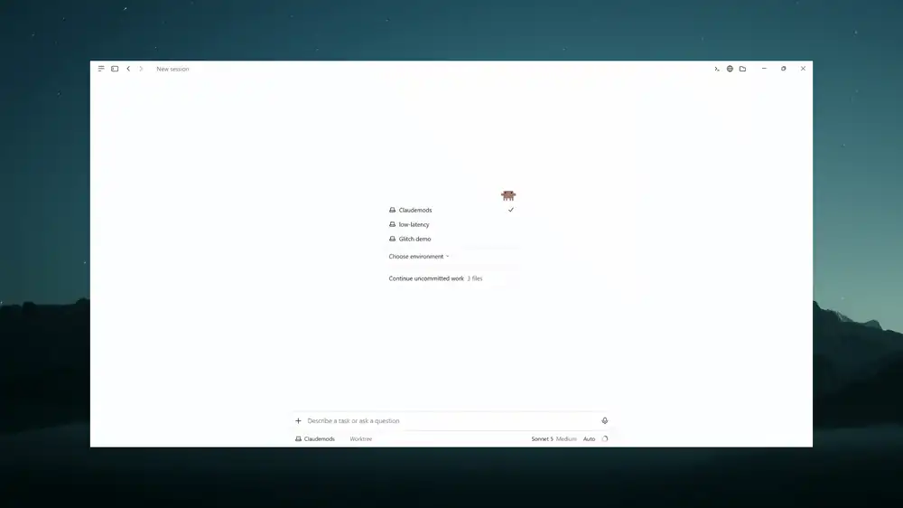
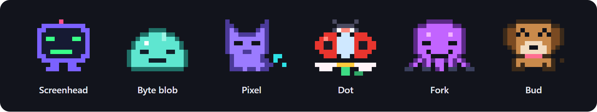

# Glitch

Glitch is a set of mods for Claude Code. It puts a status line above the prompt that tracks your session: what it's costing, how long until the prompt cache goes cold, and how much context you've used. At the end of that line sits a small pixel pet that keeps you company while Claude works.



## The pets

Glitch launches with six pets: Screenhead, Byte blob, Pixel, Dot, Fork and Bud, with more on the way, and you can [make your own](#make-your-own-pet). Each one has its own temperament, its own way of speaking and its own signature move.

Your pet isn't decoration. It works alongside Claude and pays attention to the session as it unfolds. Long turns, quiet spells, a budget running low, a run of failures or a streak kept alive all show on its face, and no two pets take them the same way. Spend some time with a few of them and pick the one that suits you.



## The status line

Claude Code's prompt cache expires after a quiet spell: an hour on a Claude subscription, 5 minutes with an API key. After that, the next message pays full price for the whole conversation again. Glitch works out which one applies to you, counts down to that moment and warns you before it arrives. One click sends a small request that keeps the cache warm. It shows what the last reply, the session and the day have cost. You can set a budget, and the cost changes color as you get close to it. The line also shows the turn number, speed, context used and your git branch, in one of six color themes.

## The crew

When Claude splits a job across several agents, a crew pane opens and your pet takes the lead. Each agent shows up as a small copy of your pet acting out its role (builder, researcher, designer, tester), with its model, progress and cost beside it. When they're all done, a reviewer checks the combined result before Claude reports back.

https://github.com/user-attachments/assets/c2072b69-8d23-466f-b132-cadaf0e76b2e

## Install

You need Claude Code 2.1.302 or later. Run these inside Claude Code:

```
/plugin marketplace add Sri-Ln/glitch
/plugin install glitch-pets@glitch
```

That installs all three plugins: `glitch-core` (themes and the `/glitch` command), `glitch-hud` (the status line) and `glitch-pets` (the pets and the crew). If you only want the status line, install `glitch-hud@glitch` instead.

Glitch works in the desktop app, VS Code and the terminal. The pets are only drawn in the desktop app. In the terminal the status line is plain text, and your pet talks to you through notifications.

## Try it

```
/glitch                  help and every command
/glitch-pets pixel       pick a pet (/glitch-pets lists them)
/glitch theme neon       change the colors
/glitch budget 5         set a $5 cap for this session
/glitch demo cache 4     preview the cache warning
```

Other settings are in `/config`, under the Glitch plugins.

## Make your own pet

Have a pet in mind? Fork the repo, open Claude Code in it and say "I want to add a pet" (or run `/new-pet`). Claude asks you about your pet, draws it in the Glitch pixel style with every mood, wires it in and runs the tests. It then opens a gallery in your browser so you can check the art before anything is committed. When you're happy, open a pull request. See [Adding a pet](docs/pets.md#adding-a-pet).

## Docs

- [Status line, budget and cache](docs/hud.md)
- [Pets](docs/pets.md)
- [Crew pane](docs/crew.md)
- [Themes](docs/themes.md)
- [All commands and settings](docs/reference.md)

## License

MIT
