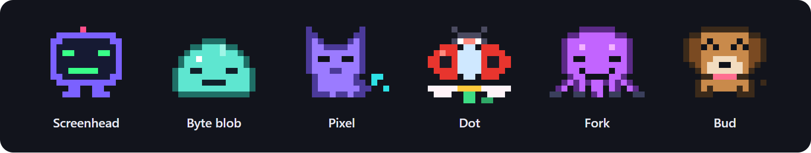

# glitch-pets

[← Back to the README](../README.md)

Pick a pet and it sits at the end of the HUD row on the desktop app. While Claude works, your pet types on a little laptop; between turns it does its signature move. It reacts to the session through moods, says a short word now and then as a toast, and keeps a daily streak. Click the pet and it hops for a moment, then goes back to what it was doing. It is not drawn in the terminal; there, remarks arrive as toasts.



| Pet | Kind | Temperament | Signature move (idle) |
|---|---|---|---|
| Screenhead | screen bot | Earnest, literal and a little robotic; reports facts, proud of tidy output. | Types; code scrolls on its screen face. |
| Byte blob | blob | Bubbly and easily startled; squeaks with joy, wobbles when worried. | Bounces: squash, stretch and a glitch slice. |
| Pixel | cat | Dry and unimpressed, secretly proud; says little, means it. | Swishes its tail and sheds pixels. |
| Dot | ladybug | Tidy, gentle and encouraging; notices the small things. | Flutters her wings on a daisy. |
| Fork | octopus | The organised multitasker; a born lead who loves a plan. | Taps four keys with four arms. |
| Bud | dog | Eager and loyal; cheers for everything and wants to go again. | Wags, pants and flops an ear. |

Moods: idle, working, happy, tired, sleepy, worried, oops, cheering, leading, reviewing, crying. It cries when the budget cap is reached, when a daily streak of two or more days is broken, and after three failures in a row.

`/glitch-pets <name | off>` switches to a pet and remembers it, or empties the slot; `/glitch-pets` alone lists the pets. `/glitch pet [name | off]` works the same way.

| Setting | Default | Meaning |
|---|---|---|
| `pet` | `bud` | your pet: screenhead, blob, pixel, dot, fork, bud or off; `/glitch pet <name>` overrides it |
| `voice` | `true` | one-line remarks as toasts |
| `voiceEveryMinutes` | `3` | at most one remark per this many minutes |
| `tiredMinutes` | `10` | a turn this long makes the pet tired |
| `sleepyMinutes` | `10` | this long without a prompt makes the pet sleepy |

```
/plugin install glitch-pets@glitch
```


When Claude splits work across agents, your pet leads the crew pane: see [Crew](crew.md).

## Adding a pet

New pets come in through pull requests. The repo has a Claude Code skill, `new-pet` (in `.claude/skills/new-pet/`), that does the work with you:

1. Fork [Sri-Ln/glitch](https://github.com/Sri-Ln/glitch) and clone your fork.
2. Open Claude Code in it and say "I want to add a pet", or run `/new-pet`.
3. Describe your pet: what it is, its name, its personality, what it does when idle and the colors you'd like.
4. Claude draws it with all 13 moods and its voice lines, adds it everywhere a pet is listed, and runs the tests.
5. A gallery opens in your browser. Check every mood on the dark and light backgrounds and in the crew pane, and ask for changes until it looks right.
6. Claude commits it and gives you a checklist. Push to your fork and open a pull request.

Every pet is reviewed before it's merged. You need Node 22.15 or later for the gallery.
